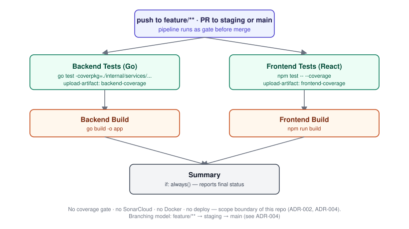
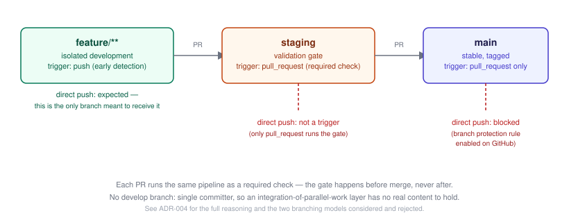

# Forum App — CI Testing

[](https://github.com/CarpinetiOctavio/forum-app-ci-testing/actions/workflows/ci.yml)
[](LICENSE)

I automated the unit tests of a small Go + React forum app with GitHub Actions. Every push to a `feature/**` branch and every pull request into `staging` or `main` runs both suites: 24 backend tests with 55.2% coverage of the Services layer, and 36 frontend tests ([run `43380208077`](https://github.com/CarpinetiOctavio/forum-app-ci-testing/actions/runs/43380208077); [screenshots](#evidence)). A ruleset blocks any merge into `staging` or `main` unless the `Test Summary` check passes, and that check fails whenever a test or build job fails ([ADR-004](docs/decisions/ADR-004-ci-pipeline-design.md), [ADR-010](docs/decisions/ADR-010-branch-protection-mechanism-migration-classic-to-rulesets.md)).

> **Series.** This is the first of three repositories: **ci-testing** → [qa-pipeline](https://github.com/CarpinetiOctavio/forum-app-qa-pipeline) → [cloud-deploy](https://github.com/CarpinetiOctavio/forum-app-cloud-deploy). The split follows the course's assignments (TP6, TP7, TP8 of Software Engineering III, UCC); in practice it would be one repository with tags.

Reading paths: in 30 seconds, the opening paragraph; in five minutes, "What this repository shows" and "Limitations"; in depth, the errors I found and corrected, and the [decision records](docs/decisions/) each point links.

## Status

Closed. This repository continues the history of the TP6 submission (October 2025) and was rebuilt as a portfolio piece in 2026. Decisions are recorded in [`docs/decisions/`](docs/decisions/). `CLAUDE.md` and [`docs/rules/`](docs/rules/) are operating instructions for an AI assistant working in this repository, not project documentation.

## What this repository shows

1. **Only the Services layer is unit-tested.** It is the only layer that branches on business rules (validation, "only the author may delete"); testing Repository would mean testing SQL against a database, which is an integration test, not a unit test ([ADR-002](docs/decisions/ADR-002-testing-scope-services-layer.md)).
2. **Mocks stand exactly at the I/O boundary.** Repositories and `axios` are replaced; the service logic runs for real. Mocking the unit itself would make the test tautological; using a real database would make it an integration test ([ADR-003](docs/decisions/ADR-003-mocking-strategy.md)).
3. **The pipeline is a gate before merge, not a check after it.** It runs on pushes to `feature/**` and on pull requests into `staging` and `main`, never on a push to `main`: with a push trigger on `main`, code could reach it without a pull request and be checked only afterwards ([ADR-004](docs/decisions/ADR-004-ci-pipeline-design.md)). A ruleset enforces it on GitHub's side ([ADR-010](docs/decisions/ADR-010-branch-protection-mechanism-migration-classic-to-rulesets.md)).
4. **Coverage is published, not enforced.** Each run uploads its coverage as an artifact; a minimum threshold is the next repository's scope (TP7), and an external service like Codecov adds an account and a token for nothing this scope needs ([ADR-004](docs/decisions/ADR-004-ci-pipeline-design.md)).
5. **`npm ci`, not `npm install`.** It fails when `package.json` and `package-lock.json` disagree, instead of silently installing a different tree ([ADR-005](docs/decisions/ADR-005-package-lock-incident.md)).
6. **Go + React instead of the course's .NET/Angular example.** The testing concepts don't depend on the stack, and both sides have a first-class mocking library ([ADR-001](docs/decisions/ADR-001-stack-choice.md)).

## Limitations

- **No real authentication.** The app trusts a client-supplied `X-User-ID` header; CORS allows any origin; lists have no pagination ([ADR-008](docs/decisions/ADR-008-app-security-scope.md), accepted limitations). Out of scope for a unit-testing repository.
- **Unit tests don't verify the real SQL or the real HTTP contract** — only how the services behave given what the mocks return ([ADR-003](docs/decisions/ADR-003-mocking-strategy.md)). Repository, Handlers and three components have no unit tests, by scope ([ADR-002](docs/decisions/ADR-002-testing-scope-services-layer.md)).
- **No coverage gate, static analysis or E2E tests here** — they are [qa-pipeline](https://github.com/CarpinetiOctavio/forum-app-qa-pipeline)'s scope. The actions are pinned by version tag, not by commit SHA, and the workflow declares no `permissions:`; that hardening belongs to the later repositories in the series.
- **Dependency advisories** in Create React App's dev tooling and in the Go standard library are recorded, not fixed ([ADR-008](docs/decisions/ADR-008-app-security-scope.md)).

## Errors I found and corrected

Each one is recorded where it was decided, with what happened, how it was found and how it was fixed.

- **The pipeline checked `main` after the fact.** The original trigger ran on a push to `main`, so code reached `main` before it was validated. I replaced it with `feature/** → staging → main` through pull requests (commit `d5ff9bc`; [ADR-004, Branching model correction](docs/decisions/ADR-004-ci-pipeline-design.md)).
- **The coverage artifact was empty.** The backend command reported `[no statements]` in every run until I added `-coverpkg=./internal/services/...`; nothing checked the content of the artifact, only that the step finished ([ADR-004](docs/decisions/ADR-004-ci-pipeline-design.md)).
- **`Test Summary` always passed.** It printed four fixed checkmarks whatever its dependencies did. I found it when choosing the check the ruleset would require, and made it fail when a dependency fails (commit `5064c01`; [ADR-004, Second correction](docs/decisions/ADR-004-ci-pipeline-design.md)).
- **The frontend jobs ran on Node.js 18, out of support since 2025-04-30.** I bumped the actions to their Node.js 24 runtime versions and left `node-version` at 18. I moved both jobs to Node.js 24 LTS ([ADR-004, Amendment 2026-11-12](docs/decisions/ADR-004-ci-pipeline-design.md)).
- **A lockfile out of sync** broke `npm ci` in October 2025; reconstructed from git history, since no CI log survives ([ADR-005](docs/decisions/ADR-005-package-lock-incident.md)).

## Decision records

| ADR | Covers |
|---|---|
| [000](docs/decisions/ADR-000-resolving-forward-not-mirroring-backward.md) | Decisions here are grounded in this repository, never copied back from a later one |
| [001](docs/decisions/ADR-001-stack-choice.md) | Go + React instead of the course's .NET/Angular example |
| [002](docs/decisions/ADR-002-testing-scope-services-layer.md) | Only the Services layer is unit-tested |
| [003](docs/decisions/ADR-003-mocking-strategy.md) | What is mocked, and why nothing else is |
| [004](docs/decisions/ADR-004-ci-pipeline-design.md) | Pipeline design: trigger, coverage artifact, no gate; and the corrections to it |
| [005](docs/decisions/ADR-005-package-lock-incident.md) | The `package-lock.json` incident of October 2025 |
| [006](docs/decisions/ADR-006-test-name-translation.md) | Test names translated to English |
| [007](docs/decisions/ADR-007-application-language.md) | The app's own UI text and error messages in English |
| [008](docs/decisions/ADR-008-app-security-scope.md) | Security hardening after `v1.0.0`, and the limitations accepted |
| [009](docs/decisions/ADR-009-comment-language-and-aaa-convention.md) | Test comment language and the Arrange-Act-Assert convention |
| [010](docs/decisions/ADR-010-branch-protection-mechanism-migration-classic-to-rulesets.md) | Branch protection moved from classic rules to a ruleset |

## Evidence





| Screenshot | Shows |
|---|---|
| [00](docs/screenshots/00-pipeline-summary-feature-push.png) | The pipeline run by a push to a feature branch |
| [01](docs/screenshots/01-branch-protection-ruleset.png) | The ruleset protecting `staging` and `main` |
| [02](docs/screenshots/02-branch-protection-gate-staging.png), [03](docs/screenshots/03-branch-protection-gate-main.png) | Merges blocked until the required check passes |
| [04](docs/screenshots/04-branch-protection-blocked-staging.png), [05](docs/screenshots/05-branch-protection-blocked-main.png) | A direct push rejected by GitHub |
| [06](docs/screenshots/06-backend-tests-passing.png), [07](docs/screenshots/07-backend-coverage.png) | Backend: 24/24 passing, 55.2% of `internal/services` |
| [08](docs/screenshots/08-frontend-tests-passing.png) | Frontend: 36/36 passing in 5 suites |
| [09](docs/screenshots/09-git-history-before-branching.png), [10a](docs/screenshots/10a-git-history-after-branching-top.png), [10b](docs/screenshots/10b-git-history-after-branching-bottom.png) | Git history before and after the branching model |

GitHub keeps Actions logs for 90 days; the screenshots are the record after that. Frontend coverage is 52.19% over all files, including files outside the tested scope ([ADR-002](docs/decisions/ADR-002-testing-scope-services-layer.md)).

## Running it

Requires Go 1.24+ and Node.js 24 (the version CI uses). No cloud account, registry or secret is needed ([`docs/SETUP.md`](docs/SETUP.md)).

```bash
git clone https://github.com/CarpinetiOctavio/forum-app-ci-testing.git
cd forum-app-ci-testing

# Backend (http://localhost:8080)
cd backend && go run cmd/api/main.go

# Frontend (http://localhost:3000), in another terminal
cd frontend && npm ci && npm start
```

Tests, the same commands CI runs:

```bash
cd backend && go test ./tests/services/... -v -cover -coverpkg=./internal/services/...
cd frontend && npm test -- --coverage --watchAll=false
```

Single-test runs, HTML coverage reports, manual checks of the mocking boundary and troubleshooting are in [`docs/COMMANDS.md`](docs/COMMANDS.md).

## AI disclosure

Language models (Claude, in chat sessions and through Claude Code) were used to audit the repository, check claims against it, and write text and code. Every design choice was decided by me, Octavio Carpineti. Only some commits carry a `Co-Authored-By` trailer for that use; the record is irregular.

## License

MIT ([LICENSE](LICENSE)).
