# Screenshots

GitHub keeps Actions logs for 90 days; these captures are the record after that. Each one states what it shows and which decision it supports. Captures 06–08 are local runs of the same commands CI runs.

## Pipeline

**00 — Pipeline run on a push to `feature/**`.** The five jobs pass, and each test job uploads its coverage as an artifact ([ADR-004](../decisions/ADR-004-ci-pipeline-design.md)).

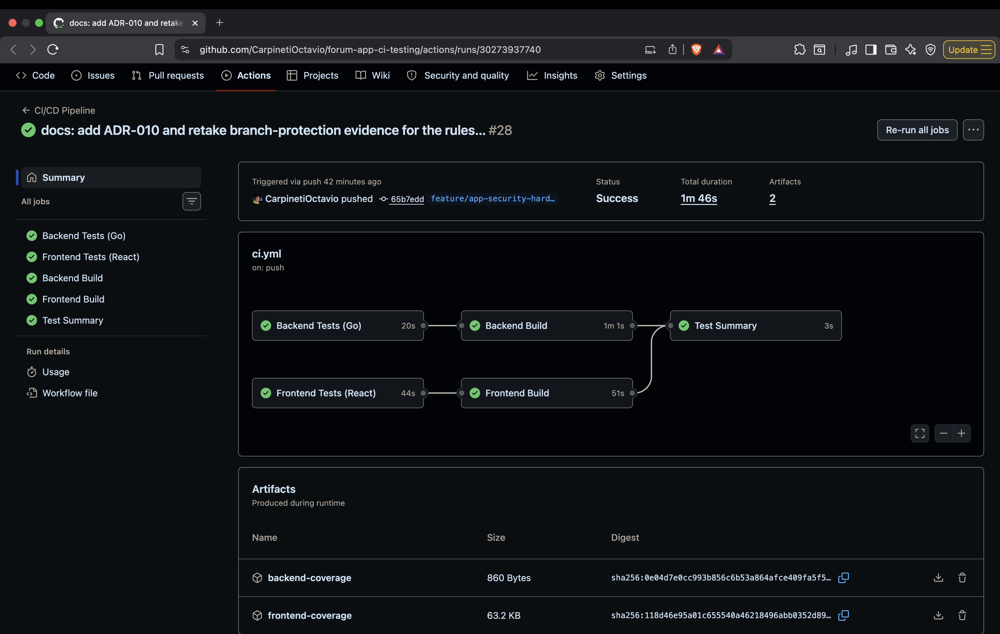

## Branch protection

**01 — The ruleset.** A single ruleset, `staging-and-main-protection`, applies four rules to `staging` and `main` ([ADR-010](../decisions/ADR-010-branch-protection-mechanism-migration-classic-to-rulesets.md)).

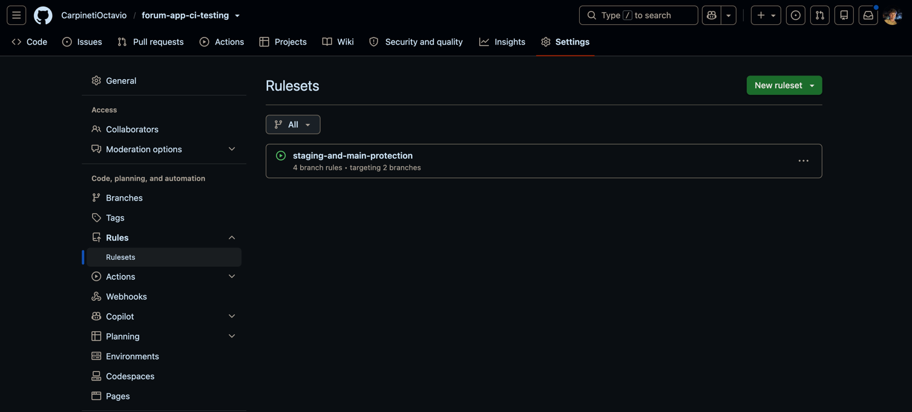

**02 — Gate on a pull request into `staging`.** Merging stays blocked while the required `Test Summary` check has not reported ([ADR-004](../decisions/ADR-004-ci-pipeline-design.md)).

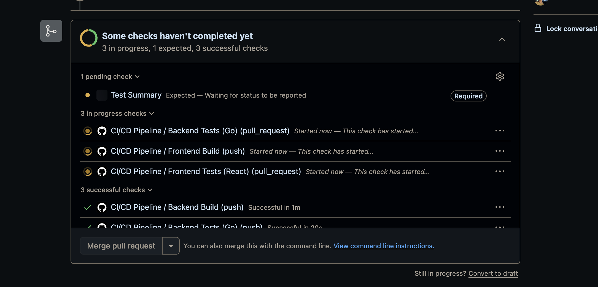

**03 — Gate on a pull request into `main`.** The same required check blocks the merge from `staging` into `main`.

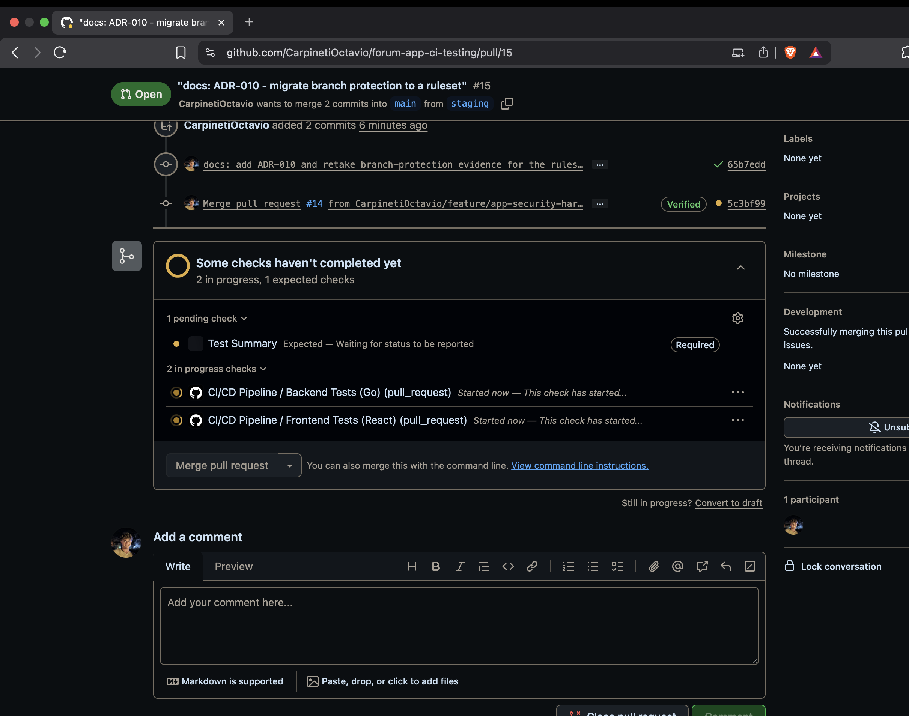

**04 — Direct push to `staging` rejected.** GitHub declines the push (GH013): changes must come through a pull request and `Test Summary` is required ([ADR-010](../decisions/ADR-010-branch-protection-mechanism-migration-classic-to-rulesets.md)).

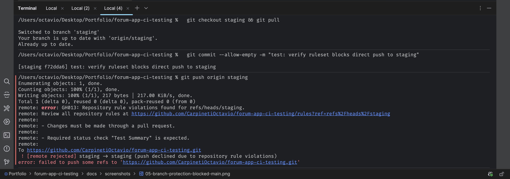

**05 — Direct push to `main` rejected.** The same rejection on `main`.

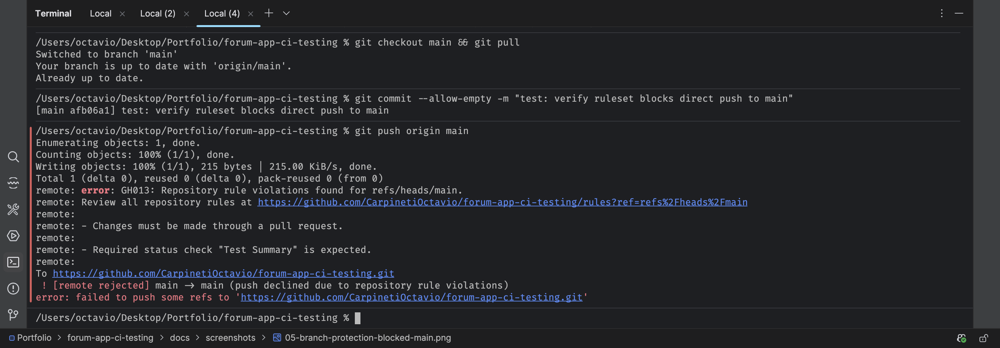

## Tests and coverage

**06 — Backend tests.** The 24 Services-layer tests pass ([ADR-002](../decisions/ADR-002-testing-scope-services-layer.md)).

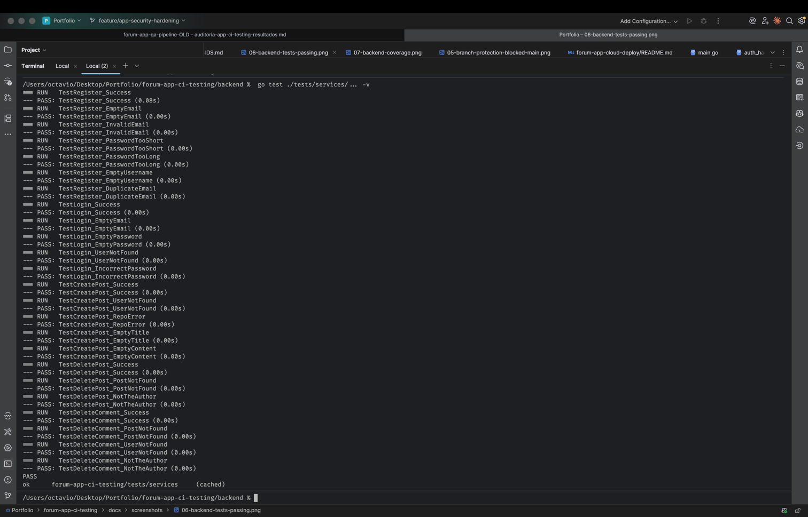

**07 — Backend coverage.** 55.2% of statements in `internal/services`, measured with `-coverpkg` ([ADR-004](../decisions/ADR-004-ci-pipeline-design.md)).

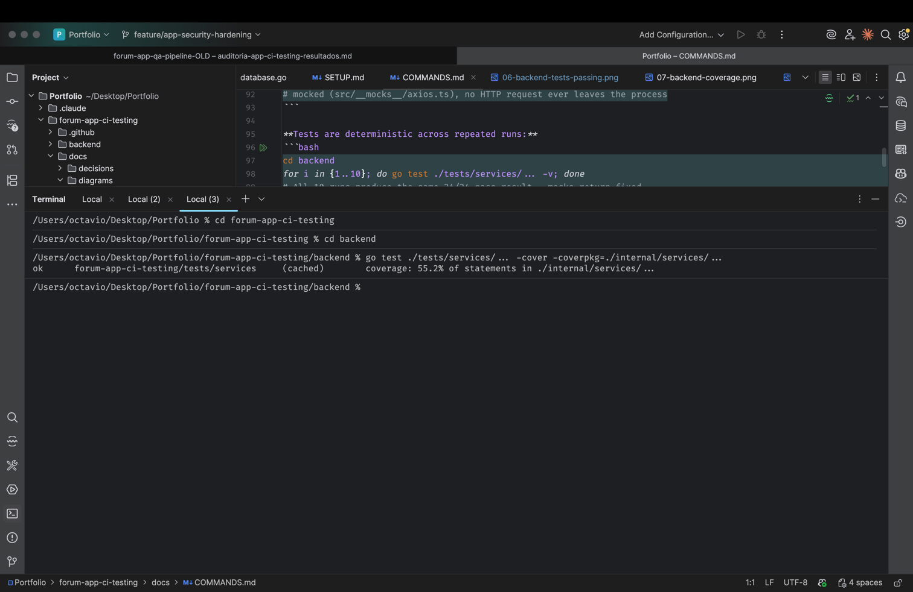

**08 — Frontend tests and coverage.** 36 tests in 5 suites pass. The uncovered files are outside the declared scope ([ADR-002](../decisions/ADR-002-testing-scope-services-layer.md)).

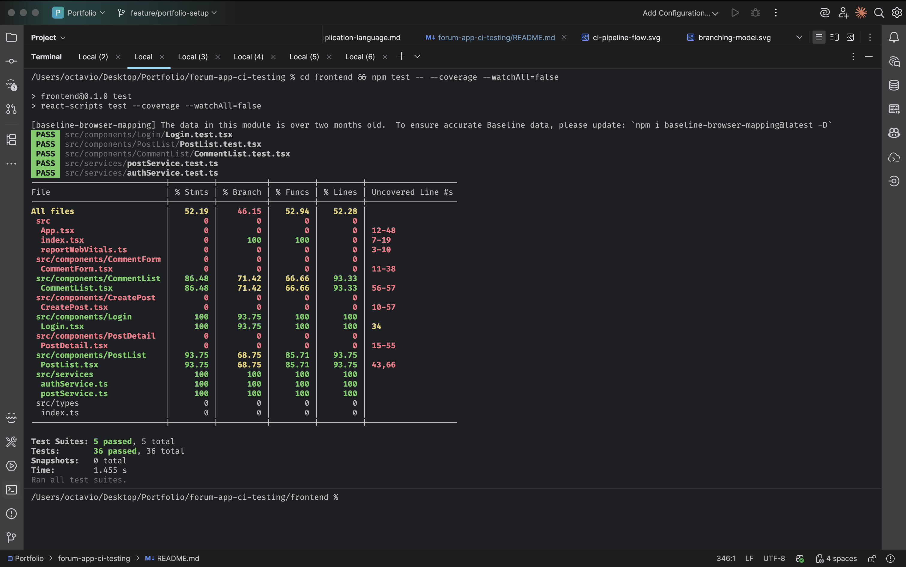

## Git history

**09 — History before the branching model.** The original October 2025 commits, all made directly on `main` ([ADR-004](../decisions/ADR-004-ci-pipeline-design.md)).

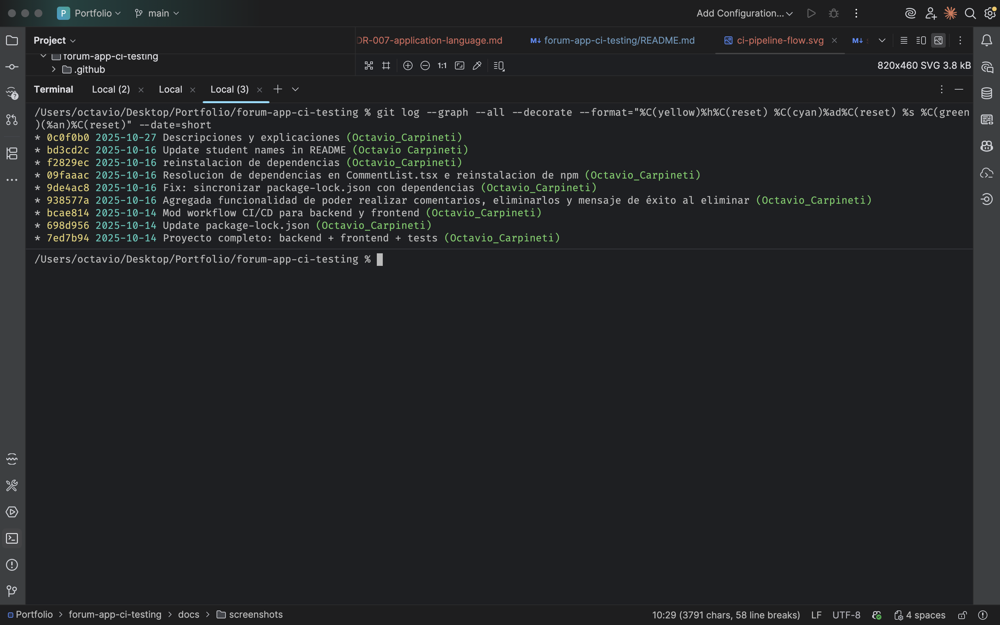

**10a, 10b — History after the branching model.** From `d5ff9bc` onward, every change reaches `main` through `feature/** → staging → main` pull requests; tags `v1.0.0` and `v1.1.0` are on `main`.

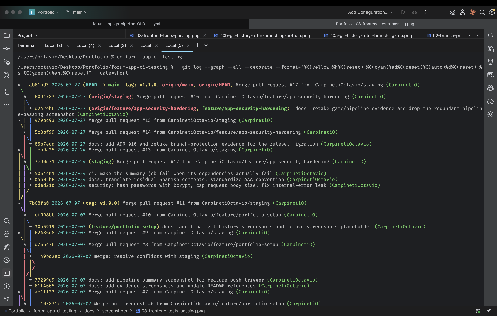

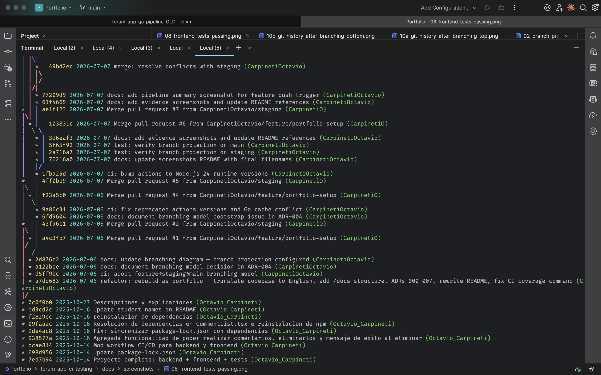
